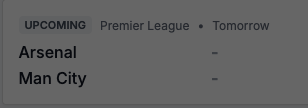
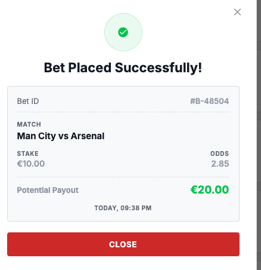
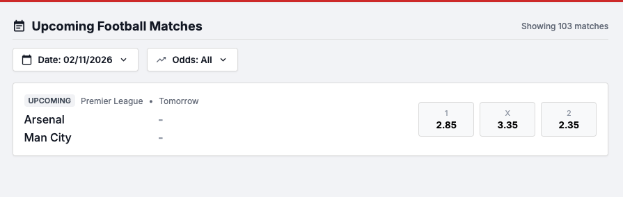
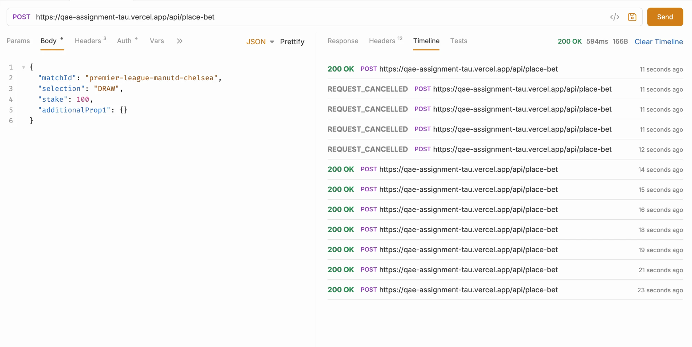

# Bug Reports - Single Bet Placement

Bugs found during scripted and exploratory testing. Attributes and severity levels follow the [Test Plan](../test-plan/test-plan-single-bet-placement.md#33-bug-attributes).

| ID & Title | Severity | Reproduction Steps | Expected Result | Actual Result | Business Impact | Evidence |
|------------|----------|--------------------|-----------------|---------------|-----------------|----------|
| **BUG-01** Balance reset does not persist €125.50 (balance stays €120.00) | High | **Preconditions:** user is logged in; balance differs from the initial value. **Test data:** initial balance €125.50. 1. Call `POST /api/reset-balance`. 2. Call `GET /api/balance`. 3. Refresh the app and check the balance in the header and bet slip. | Reset returns status code `200` with body `{"message": "Balance reset successfully", "balance": 125.5, "currency": "EUR"}`; `GET /api/balance` returns `{"balance": 125.5, "currency": "EUR"}`; header shows **€125.50**. | The reset response says `balance: 125.5`, but the saved balance is **€120.00**: `GET /api/balance` and the header both show €120.00. The response and the persisted state are inconsistent (spec §5.3). | Users start with less money than the system reports, and the API confirms a balance that was never saved. Every balance check after a reset is unreliable. |  **`POST /api/reset-balance` response:** `{"message": "Balance reset successfully", "balance": 125.5, "currency": "EUR"}` **Confirmed in TC-02:** after a reset, a €100.00 bet returns `balance: 20` (120.00 − 100.00, not 125.50 − 100.00). Found during exploratory testing. |
| **BUG-02** Receipt shows teams in the wrong order (away vs home) | High | **Preconditions:** user is logged in; balance is reset. **Test data:** selection `1` on Arsenal vs Man City, stake `10.00`. 1. Note the balance in the header. 2. On an upcoming match, click the `selection` odds and note the odds. 3. Enter the `stake` in the bet slip. 4. Click `Place Bet button`. | Receipt shows the match as **home vs away**, the same order as the match list: **Arsenal vs Man City**. | Receipt shows the match as **away vs home**: **Man City vs Arsenal**. | Users can't be sure which team they bet on, which leads to confusion, disputes and support requests. |   **Backend check:** in DevTools, `POST /api/place-bet` request and response both have `selection: "HOME"` for Arsenal vs Man City, so the bet is stored correctly; only the receipt display is wrong. |
| **BUG-03** Receipt shows an incorrect potential payout | Critical | **Preconditions:** user is logged in; balance is reset. **Test data:** selection `1` on Arsenal vs Man City, stake `10.00`. 1. Note the balance in the header. 2. On an upcoming match, click the `selection` odds and note the odds. 3. Enter the `stake` in the bet slip. 4. Click `Place Bet button`. | Potential payout = `stake × odds` = €10.00 × 2.85 = **€28.50**. | Receipt shows a potential payout of **€20.00**. | Users are shown the wrong winnings. If the stored payout is also wrong, winning bets are paid incorrectly, causing financial loss and regulatory risk. |  |
| **BUG-04** Balance in the UI is not updated after a successful bet | High | **Preconditions:** user is logged in; balance is reset. **Test data:** selection `1` on Arsenal vs Man City, stake `10.00`. 1. Note the balance in the header. 2. On an upcoming match, click the `selection` odds and note the odds. 3. Enter the `stake` in the bet slip. 4. Click `Place Bet button`. 5. Close the receipt. | Header and bet slip balance = previous balance − stake: €120.00 − €10.00 = **€110.00**. | The bet is placed, but the header and bet slip still show **€120.00**. The backend does deduct the stake (see TC-02: `balance: 20` after a €100.00 bet), so only the UI is not refreshed. | Users see more money than they have and may try bets that the backend will reject, which leads to confusion and support requests. |   |
| **BUG-05** Receipt does not show the selection | Low | **Preconditions:** user is logged in; balance is reset. **Test data:** selection `1` on Arsenal vs Man City, stake `10.00`. 1. Note the balance in the header. 2. On an upcoming match, click the `selection` odds and note the odds. 3. Enter the `stake` in the bet slip. 4. Click `Place Bet button`. | Receipt shows the selection | Receipt shows Bet ID, match, stake, odds, payout and timestamp, but **no selection**. | Cosmetic: the user can't see the chosen outcome on the receipt, but the bet is stored correctly. |  |
| **BUG-06** API returns an incorrect payout for some odds (409.99 instead of 410.00) | High | **Preconditions:** balance is reset; a valid upcoming `matchId` is available. **Test data:** header `x-user-id: candidate-ZrzbrQMxczHo`; body `{"matchId": "ligue-1-marseille-psg-2026-11-17", "selection": "HOME", "stake": 100.00}` (Marseille vs PSG, home odds 4.1). 1. Call `GET /api/matches` and take the `id` of an upcoming match. 2. Call `POST /api/place-bet` with stake `100.01`. 3. Call `GET /api/balance`. 4. Call `POST /api/place-bet` with stake `100.00`. | Status code `200` with `payout` = `stake × odds` = 100.00 × 4.1 = **410.00**. | Status code `200`, but `payout` is **409.99** (€0.01 short). The error depends on the odds value: the same €100.00 stake on Man Utd vs Chelsea (odds 2.45) returns the correct payout `245`. Likely cause: the floating-point result (`100 × 4.1 = 409.99999999999994`) is truncated instead of rounded to 2 decimals. | Users are paid less than they are owed. A rounding error repeated across many bets means systematic underpayment and regulatory risk. | **`POST /api/place-bet` (stake `100.00`) → `200`:** `{"message": "Bet placed successfully", "matchId": "ligue-1-marseille-psg-2026-11-17", "selection": "HOME", "stake": 100, "odds": 4.1, "payout": 409.99, "balance": 20, "currency": "USD"}` **Comparison, correct payout:** `{"message": "Bet placed successfully", "matchId": "premier-league-manutd-chelsea", "selection": "HOME", "stake": 100, "odds": 2.45, "payout": 245, "balance": 20, "currency": "USD"}` |
| **BUG-07** API returns the wrong currency (USD instead of EUR) | High | **Preconditions:** balance is reset; a valid upcoming `matchId` is available. **Test data:** header `x-user-id: candidate-ZrzbrQMxczHo`; body `{"matchId": "ligue-1-marseille-psg-2026-11-17", "selection": "HOME", "stake": 100.00}` (Marseille vs PSG, home odds 4.1). 1. Call `GET /api/matches` and take the `id` of an upcoming match. 2. Call `POST /api/place-bet` with stake `100.01`. 3. Call `GET /api/balance`. 4. Call `POST /api/place-bet` with stake `100.00`. | Status code `200` with `currency: "EUR"`, as required by the business rules (§3) and the API spec (§5.3). | Status code `200`, but `currency` is **`"USD"`**. | Amounts are in euros but labelled as dollars. Any client, report or conversion that relies on this field shows or calculates the wrong money. | **`POST /api/place-bet` (stake `100.00`) → `200`:** `{"message": "Bet placed successfully", "matchId": "ligue-1-marseille-psg-2026-11-17", "selection": "HOME", "stake": 100, "odds": 4.1, "payout": 409.99, "balance": 20, "currency": "USD"}` |
| **BUG-08** Match count label does not update after filtering | Low | **Preconditions:** user is logged in. **Test data:** date filter `02/11/2026`. 1. Open the app. 2. Apply the date filter `02/11/2026`. 3. Check the match count label above the list. | Label shows the number of matches in the filtered list: **"Showing 1 match"**. | Only 1 match (Arsenal vs Man City) is listed, but the label still shows **"Showing 103 matches"**. | Cosmetic: the label misleads users about how many matches fit their filter, but filtering itself works. |  Found during exploratory testing. |
| **BUG-09** Bets are accepted when the stake exceeds the available balance | Critical | **Preconditions:** user is logged in; balance is reset. **Test data:** stake `100.00`, selection `HOME` on AC Milan vs Inter (`serie-a-ac-milan-inter-2026-12-10`, odds 2.65). 1. Place a bet with stake `100.00`. 2. Without refreshing, place another bet with stake `100.00`. | Once the stake exceeds the available balance, the bet is rejected with **"Insufficient balance"** in the UI and the API (status code `422`, spec §4.1). The balance never goes below €0.00. | Bets keep being **accepted** with status code `200`, and the balance goes **negative (-180)**. The UI still shows the old balance (see [BUG-04](#bug-04)), so the user doesn't know they have run out of money. | Users can bet money they don't have, creating debt and a direct financial loss for the business. | **`POST /api/place-bet` → `200`:** `{"message": "Bet placed successfully", "matchId": "serie-a-ac-milan-inter-2026-12-10", "selection": "HOME", "stake": 100, "odds": 2.65, "payout": 265, "balance": -180, "currency": "USD"}` Found while executing TC-03. **API client timeline:** 7 × `200 OK` for `stake: 100` within about 12 seconds.  |
