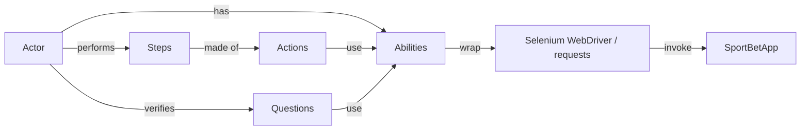

# Sportsbet Test Framework

UI and API test framework for **Single Bet Placement**, built with the **Screenplay pattern**.

**Stack:** Python 3.14 · Selenium WebDriver · pytest · requests · Allure · uv

## Prerequisites

| Tool | Purpose | Install |
|------|---------|---------|
| [uv](https://docs.astral.sh/uv/) | Python version and dependency management | `brew install uv` |
| Google Chrome | Browser for UI tests (the driver is downloaded automatically by Selenium Manager) | [chrome](https://www.google.com/chrome/) |
| [Allure](https://allurereport.org/) | Test report viewer | `brew install allure` |

## Setup

```bash
git clone https://github.com/AlejandroAreiza/sporty-home-assignment.git
cd sporty-home-assignment/sportsbet-test-framework
uv sync
cp .env.example .env
```

Then set your values in `.env`:

| Variable | Description |
|----------|-------------|
| `QA_BASE_URL` | Application URL, e.g. `https://qae-assignment-tau.vercel.app` |
| `QA_USER_ID` | Your candidate user ID |

## Run

```bash
uv run pytest
```

## Report

```bash
allure serve allure-results
```

## Lint

```bash
uv run ruff check .
uv run ruff format .
```

## Screenplay Pattern

An **Actor** has **Abilities**, performs **Steps** made of **Actions**, and verifies the result with **Questions**.



| Part | Role | Example |
|------|------|---------|
| Actor | The user of the system | Bettor |
| Ability | Wraps a tool | BrowseTheWeb, CallAnApi |
| Action | One low-level action | Open, Click, Enter, Get, Post |
| Step | A business step made of actions | PlaceBet, ResetBalance |
| Question | Reads the system state for assertions | TheBalance |

### Example test

```python
# conftest.py
@pytest.fixture
def api_user():
    actor = Actor.named("Api User").who_can(CallAnApi.at(BASE_URL, headers={"x-user-id": USER_ID}))
    yield actor
    actor.exit()


# test: only says what the actor does
def test_reset_balance_restores_initial_balance(api_user):
    api_user.attempts_to(ResetBalance.to_initial_value())

    api_user.verifies(TheBalance.in_the_api(), {"balance": 125.5, "currency": "EUR"})
```
