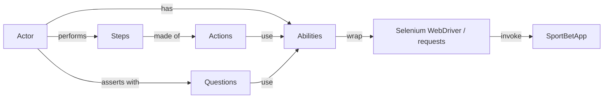

# Sportsbet Test Framework

UI and API test framework for **Single Bet Placement**, built with the **Screenplay pattern**.

**Stack:** Python 3.14 · Selenium WebDriver · pytest · requests · Allure · uv · Ruff

## Screenplay Pattern

An **Actor** (the user) has **Abilities** (a browser, an API client). It performs **Steps** (business actions such as placing a bet), which are made of **Actions** (one click, one request), and it checks the system with **Questions** (read a text, read the balance). Tests read like the test case, and each piece is small and reusable: a changed locator is fixed once in `ui/`, and a new test mostly reuses existing steps and questions.



| Part | Role | Examples |
|------|------|----------|
| Actor | The user of the system | `player` (browser + API), `api_player` (API only) |
| Ability | Wraps a tool | `BrowseTheWeb`, `CallAnApi` |
| Action | One low-level action | `Click`, `Enter`, `OpenWebPage`, `Post` |
| Step | A business step made of actions | `PlaceBet`, `ResetBalance` |
| Question | Reads the system state | `TheText`, `IsEnabled`, `TheBalance`, `TheMatches` |

## Folder Structure

```
sportsbet-test-framework/
├── config/
│   ├── endpoints.py          # API paths
│   └── settings.py           # reads .env (QA_BASE_URL, QA_USER_ID)
├── screenplay/
│   ├── actor.py              # Actor: abilities, attempts_to, asks_for, asserts, asserts_soft
│   ├── fluent_wait.py        # generic polling wait used by asserts
│   ├── interfaces/           # Ability, Performable, Question
│   ├── abilities/            # BrowseTheWeb (Selenium), CallAnApi (requests)
│   ├── actions/
│   │   ├── api/              # Post
│   │   └── ui/               # Click, Enter, OpenWebPage
│   ├── steps/
│   │   ├── api/              # PlaceBet, ResetBalance
│   │   └── ui/               # PlaceBet
│   ├── questions/
│   │   ├── api/              # TheBalance, TheMatches
│   │   └── ui/               # TheText, IsEnabled, ThePageTitle
│   ├── ui/                   # page elements only (Header, MatchList, BetSlip, Receipt)
│   └── models/               # Selection (HOME / DRAW / AWAY)
└── tests/
    ├── conftest.py           # driver, actors (player, api_player), --headless, assert hook
    ├── api/                  # TC-02 + API smoke test
    └── e2e/                  # TC-01 + UI smoke test
```

## Prerequisites

| Tool | Purpose | Install |
|------|---------|---------|
| [uv](https://docs.astral.sh/uv/) | Python and dependency management | `brew install uv` |
| Google Chrome | Browser for UI tests (the driver is downloaded automatically by Selenium Manager) | [google.com/chrome](https://www.google.com/chrome/) |
| [Allure](https://allurereport.org/) | Test report viewer | `brew install allure` |

## Setup

```bash
git clone https://github.com/AlejandroAreiza/sporty-home-assignment.git
cd sporty-home-assignment/sportsbet-test-framework
uv sync
cp .env.example .env
```

Set your values in `.env`:

| Variable | Description |
|----------|-------------|
| `QA_BASE_URL` | Application URL, e.g. `https://qae-assignment-tau.vercel.app` |
| `QA_USER_ID` | Your candidate user ID |

## Run

| Command | Runs |
|---------|------|
| `uv run pytest` | All tests |
| `uv run pytest -m smoke` | Smoke tests: is the app up |
| `uv run pytest -m regression` | Regression tests (TC-01, TC-02) |
| `uv run pytest -m api` / `-m ui` | API or UI tests only |
| `uv run pytest --headless` | Any of the above, with Chrome running without a window |
| `uv run pytest --reruns 1` | Any of the above with 1 retry (the default is 0 retries) |
| `uv run pytest --clean-alluredir` | Any of the above, clearing the previous report results |

Report:

```bash
allure serve allure-results
```

Lint and format:

```bash
uv run ruff check .
uv run ruff format .
```

## Write a Test

1. **Pick an actor fixture:** `api_player` for API tests, `player` for UI tests (it starts with a reset balance and open the SportBetApp as logged user).
2. **Arrange:** read test data with questions, e.g. `match = player.asks_for(TheMatches().upcoming())[0]`.
3. **Act:** perform steps, e.g. `player.attempts_to(PlaceBet().on_match(match["id"]).with_selection(Selection.HOME))`.
4. **Assert:**
   - `asserts(question_or_value, expected)`: **hard**, stops the test (use when the rest of the test can't continue).
   - `asserts_soft(question_or_value, expected)`: **soft**, records the failure and continues. At the end, the test fails with one summary of every failed assert.

```python
@pytest.mark.regression
@pytest.mark.ui
def test_place_a_valid_single_bet_on_an_upcoming_match(self, player):
    match = player.asks_for(TheMatches().upcoming())[0]

    player.attempts_to(PlaceBet().on_match(match["id"]).with_selection(Selection.HOME))
    player.asserts_soft(TheText.of(BetSlip.MATCH), f"{match['homeTeam']} vs {match['awayTeam']}")

    player.attempts_to(PlaceBet().with_stake(10.00))
    player.asserts(IsEnabled.the(BetSlip.PLACE_BET_BUTTON), True)
```

## Conventions

- **Locators:** ID first, then CSS, XPath only as a last resort: `UIElement.by_id(...)`, `UIElement.by_css(...)`, `UIElement.by_xpath(...)`. Every element has a readable name for the report.
- **Waits:** no `sleep`. Selenium's fluent wait finds and clicks elements, and asserts on questions poll for up to 2 seconds until the value matches.
- **Reporting:** every action, question and assert is an Allure step.
